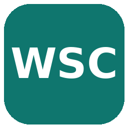
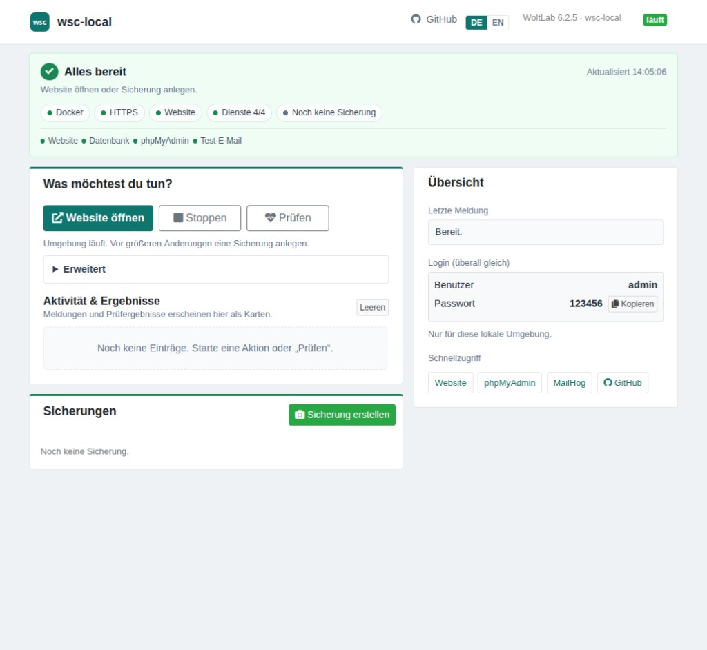

<p align="center">
  
</p>

<h1 align="center">wsc-local</h1>

<p align="center">
  <strong>Local</strong> WoltLab Suite Core to try and develop<br>
  Set up once · one login · control everything in the browser
</p>

<p align="center">
  <a href="README.md">Deutsch</a> (default)
</p>

<p align="center">
  
</p>

---

## How to use it

### Once

You need [Docker](https://docs.docker.com/get-docker/) and [mkcert](https://github.com/FiloSottile/mkcert).

```bash
git clone https://github.com/benjarogit/wsc-local.git
cd wsc-local
./setup.sh --en
```

Setup downloads WoltLab, configures `https://wsc.local`, and asks for username & password.

### Every day

| | |
|--|--|
| **Easiest** | Open **“wsc-local”** from your app menu |
| **Or in a terminal** | `./start.sh` — starts everything and opens the control panel |

Done. You can close the terminal — keep working in the **browser**.

---

## Your URLs

| | |
|--|--|
| **WoltLab** | https://wsc.local |
| **Control panel** | http://127.0.0.1:9099 |
| **Database** | http://localhost:8081 |
| **Test email** | http://localhost:8025 |

Your login is shown after setup and anytime in the control panel (one-click copy).

---

## What the panel can do

- Status at a glance (ready / attention / problem)
- Start, stop, open the site
- Create and restore backups
- Switch German / English

Other apps and Docker projects on your machine stay untouched.

---

## Start over

```bash
./reset.sh              # remove the environment (keep backups)
./reset.sh --purge-all  # remove everything
./setup.sh --en         # set up again
```
